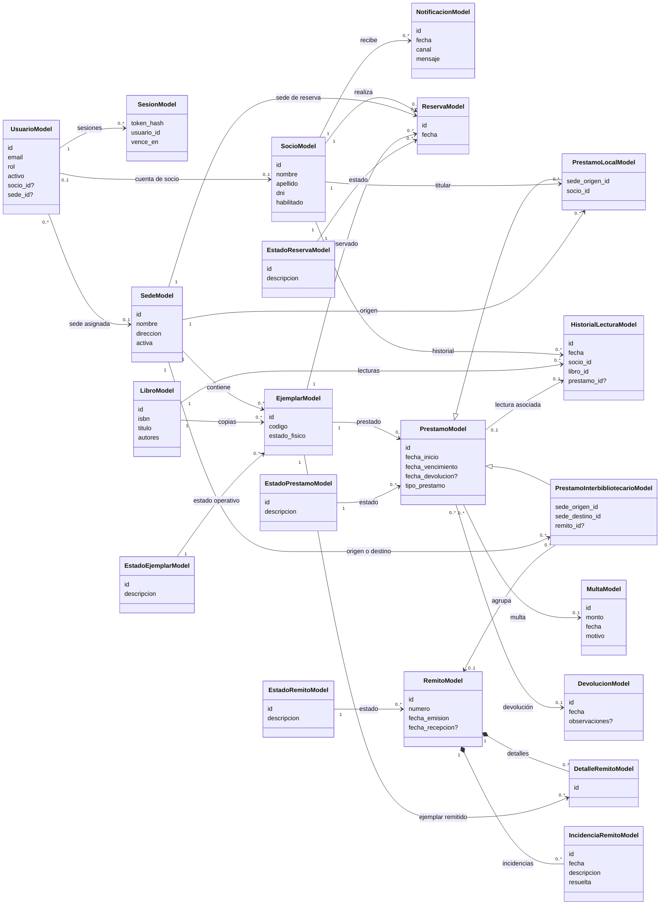
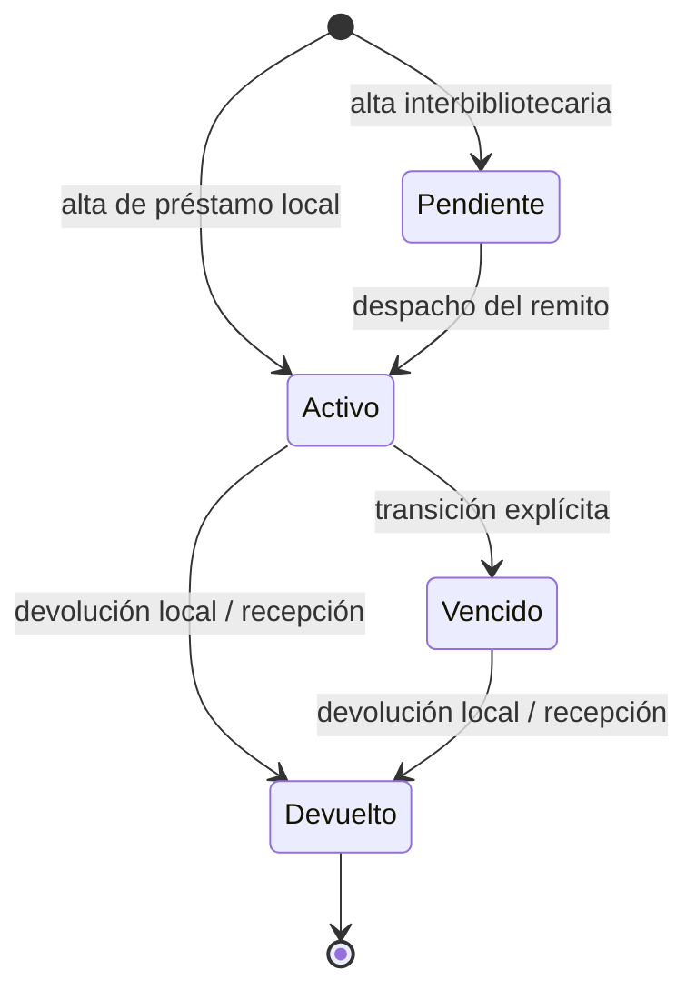
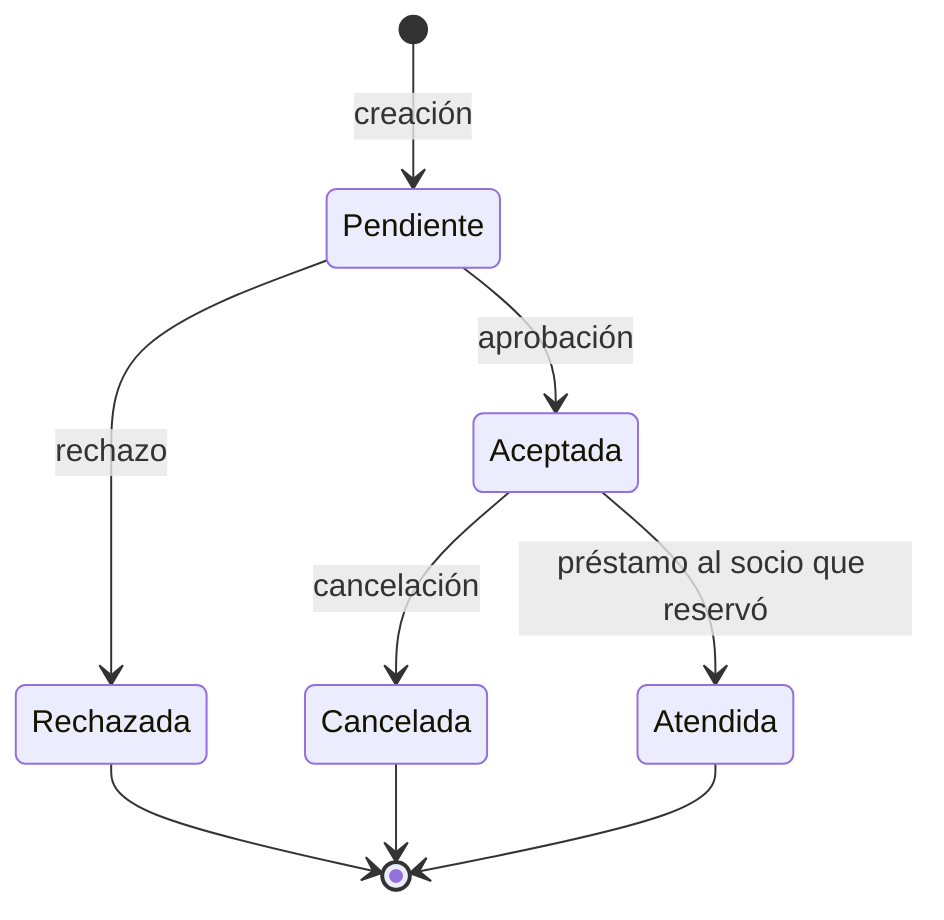
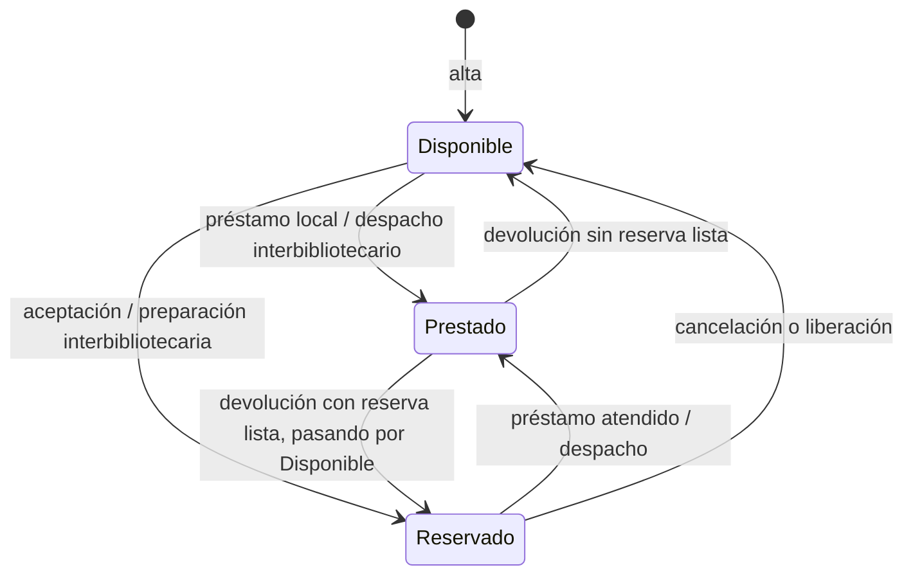
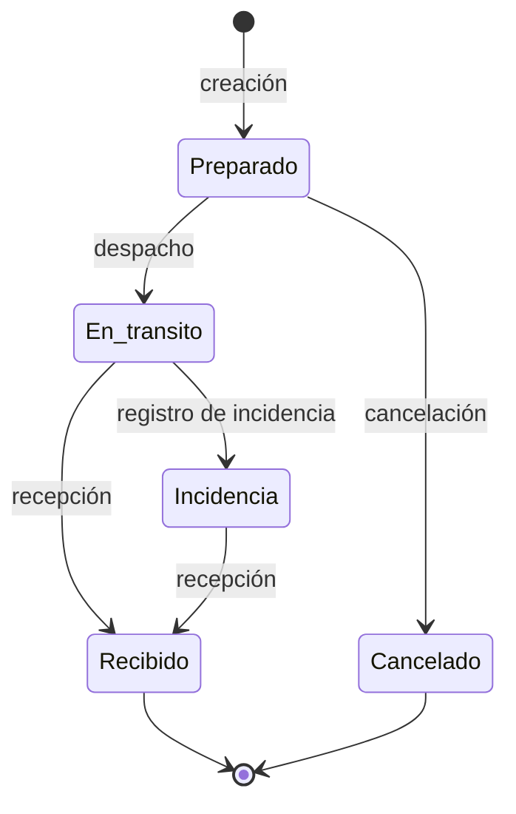

# Documentación técnica del dominio

Este documento describe los patrones visibles en la implementación, los reportes, las entidades del dominio, sus ciclos de vida y las reglas de negocio principales. Se basa en el backend de `backend/src`; cuando corresponde, se aclara qué reportes están disponibles en la API y cuáles aparecen en el selector del frontend.

## Patrones utilizados

### State en los préstamos

El ciclo de vida de los préstamos está modelado en `prestamo_state.py`: cada estado concreto conoce su nombre y las transiciones permitidas. `validate_prestamo_transition` compara el estado actual con el destino y rechaza los cambios inválidos. `prestamo_workflow.py` centraliza el cambio y sus efectos asociados, como marcar el ejemplar prestado o liberarlo al devolverlo.

Este patrón encaja con un préstamo porque su comportamiento depende de su estado: no todo cambio es válido desde cualquier punto y la devolución tiene reglas adicionales. La lógica explícita evita que cada ruta invente sus propias transiciones.

Alternativas posibles:

- Un `Enum` más una tabla de transiciones centralizada puede ser más simple si los estados solo difieren en sus permisos y no requieren comportamiento propio.
- Una máquina de estados declarativa o una librería de workflows puede resultar útil si el proceso crece, requiere auditoría de transiciones o debe configurarse sin cambiar código.

El patrón State solo está implementado como clases para préstamos. Las reservas, los ejemplares y los remitos tienen sus transiciones expresadas mediante mapas de estados y validaciones en sus rutas.

### Observer para notificaciones

`prestamo_observer.py` define eventos de cambios de préstamo y reserva, un sujeto (`EstadoSubject`) y un observador (`NotificacionObserver`). Cuando los flujos que usan el sujeto notifican un cambio, el observador agrega una notificación a la misma sesión de base de datos.

La separación permite agregar otros observadores sin acoplar su lógica directamente a las rutas de préstamo o reserva. En el estado actual, la notificación es síncrona y se persiste con el canal `sistema`; no es un envío de correo ni un evento procesado por una cola.

Alternativas posibles:

- Llamar a la creación de notificaciones directamente desde cada endpoint es más sencillo al inicio, pero acopla los flujos a la notificación.
- Un bus de eventos o una cola de mensajes sería apropiado si se agregan correo, push, reintentos o procesamiento asíncrono.

El Observer se invoca desde determinados flujos de cambio de estado; no todo alta de entidad genera por sí misma una notificación.

### Herencia polimórfica de préstamos

`PrestamoModel` concentra los datos comunes. `PrestamoLocalModel` y `PrestamoInterbibliotecarioModel` heredan de él y guardan sus campos específicos en tablas separadas. SQLAlchemy usa `tipo_prestamo` como discriminador, por lo que una consulta de la clase base puede devolver ambos tipos.

Esto permite consultar y reportar los préstamos como una familia, manteniendo explícitas las diferencias entre un préstamo local y uno entre sedes.

Alternativas posibles:

- Composición: una entidad de préstamo común y detalles asociados según el tipo, si se quiere reducir la herencia ORM.
- Un único modelo con campos opcionales, más simple en tablas pequeñas, pero con combinaciones inválidas de campos y más validaciones.
- Una estrategia por tipo de préstamo puede encapsular reglas que hoy están repartidas entre validadores y rutas si los tipos crecen.

### Separación por capas y rutas

FastAPI organiza la API por routers; SQLAlchemy define la persistencia en los modelos; `library_rules.py` concentra validaciones compartidas y `prestamo_workflow.py` coordina cambios de estado. El frontend Flet consume la API y contiene sus propias vistas.

No hay un patrón Repository explícito: los routers consultan SQLAlchemy directamente. Incorporar repositorios o servicios de aplicación podría aislar más la persistencia si el proyecto necesita cambiar de almacenamiento o reutilizar casos de uso fuera de HTTP, pero agregaría abstracción que hoy no está presente.

## Reportes realizados

Los ocho reportes están implementados en `backend/src/routers/reportes.py` y requieren rol `bibliotecario` o `admin`. El selector de la vista Flet (`frontend/ui/views/reportes/reportes.py`) ofrece cinco: préstamos activos, préstamos vencidos, libros más solicitados, disponibilidad por sede y material en tránsito. Los reportes de multas, envíos y movimientos interbibliotecarios están en la API, pero no en ese selector.

| Reporte | Endpoint | Lógica de cálculo |
|---|---|---|
| Préstamos activos | `GET /api/reportes/prestamos-activos` | Incluye préstamos abiertos, con vencimiento hoy o posterior, cuyo estado es `Activo` o `En curso`. Un préstamo está abierto si no tiene fecha de devolución y su estado no es `Devuelto`, `Cancelado` ni `Finalizado`. |
| Préstamos vencidos | `GET /api/reportes/prestamos-vencidos` | Incluye préstamos abiertos con vencimiento anterior a hoy y estado `Activo`, `En curso`, `Vencido` o `Atrasado`. La fecha permite reportar el atraso aunque el estado todavía no se haya cambiado a `Vencido`. |
| Multas | `GET /api/reportes/multas` | Devuelve cada multa con su monto, fecha y motivo, más los IDs de préstamos que la referencian y los IDs de socio obtenidos de esos préstamos. No calcula una suma por socio. |
| Libros más solicitados | `GET /api/reportes/libros-mas-solicitados` | Suma una solicitud por préstamo no cancelado y una por reserva no cancelada, agrupando por libro. Devuelve los libros ordenados por cantidad descendente. No excluye préstamos devueltos ni reservas rechazadas o atendidas. |
| Disponibilidad por sede | `GET /api/reportes/disponibilidad-por-sede` | Agrupa ejemplares por sede y libro. `ejemplares` cuenta todas las copias del grupo; `disponibles` cuenta las que pasan la regla común de disponibilidad. Solo devuelve grupos cuyos libros y sedes existen. |
| Envíos | `GET /api/reportes/envios` | Cuenta remitos totales, recibidos, en tránsito e incidencias (registros de incidencia). La tasa es `recibidos / remitos_totales * 100`; los cancelados también forman parte del total. El promedio de tránsito es la media de días entre emisión y recepción para remitos recibidos con fecha de recepción. Si no hay datos para una tasa, devuelve `0`; si no hay duraciones, devuelve `null`. |
| Material en tránsito | `GET /api/reportes/material-en-transito` | Para cada remito en tránsito, recorre sus detalles y los cruza con préstamos interbibliotecarios asociados al remito y al ejemplar. Omite detalles sin ejemplar o préstamo correspondiente. |
| Movimientos interbibliotecarios | `GET /api/reportes/movimientos-interbibliotecarios` | Agrupa préstamos interbibliotecarios por sede de origen y destino, cuenta envíos y calcula la media de días de tránsito para los asociados a remitos recibidos. Sin duraciones, el promedio es `null`. |

La disponibilidad usada por el reporte requiere que el estado operativo del ejemplar sea `Disponible`, que su condición física no sea `Extraviado` ni `Destruido`, y que no tenga un préstamo abierto. La condición `Dañado` no lo excluye por sí sola.

**Incidencia conocida:** el cálculo de libros más solicitados accede a `reservation.estado`, pero `ReservaModel` solo define la FK `estado_reserva_id` y no declara una relación ORM llamada `estado`. Por eso, si hay reservas en la base, ese endpoint puede terminar con `AttributeError` antes de devolver el reporte. La lógica descrita en la tabla es la intención expresada por la ruta; habría que resolver el estado mediante la FK o declarar la relación ORM para que se ejecute.

## Objetos del dominio

El siguiente diagrama resume las entidades SQLAlchemy y sus relaciones principales. Las multiplicidades reflejan las claves foráneas del modelo; algunas reglas adicionales (por ejemplo, limitar una devolución a un préstamo) se validan en la aplicación.

### Descripción de los grupos de objetos

- **Acceso:** `UsuarioModel` representa las cuentas y su rol. `SesionModel` almacena el hash del token y su vencimiento. Una cuenta puede estar vinculada a un socio y/o asignada a una sede.
- **Catálogo e inventario:** `LibroModel` representa la obra; `EjemplarModel`, cada copia física en una sede. `estado_fisico` describe su condición material, mientras que `EstadoEjemplarModel` registra su situación operativa.
- **Circulación:** `ReservaModel` relaciona socio, ejemplar y sede. `PrestamoModel` concentra campos comunes y sus subtipos representan circulación local o interbibliotecaria.
- **Traslados:** `RemitoModel` agrupa préstamos interbibliotecarios y sus ejemplares mediante `DetalleRemitoModel`; `IncidenciaRemitoModel` registra problemas durante el tránsito.
- **Cierre y seguimiento:** `DevolucionModel` documenta el retorno; `MultaModel`, el cargo asociado opcionalmente al préstamo; `HistorialLecturaModel`, la lectura registrada al completar un préstamo local.
- **Estados:** las tablas `Estado*Model` son catálogos de estados, no clases con comportamiento propio. Las reglas de transición están en los flujos de aplicación.

## Máquinas de estados

Los nombres se normalizan ignorando mayúsculas y tildes al validar. Los estados de referencia se inicializan en `bootstrap.py`; los alias indicados a continuación son aceptados por algunas reglas, pero no necesariamente se crean como estados.

### Préstamo

- `Pendiente`: préstamo interbibliotecario creado, todavía no despachado.
- `Activo`: préstamo en curso; los préstamos locales deben empezar en este estado.
- `Vencido`: préstamo activo que se atrasó. La transición a este estado no la ejecuta un programador automático en el código inspeccionado. Los reportes también identifican vencidos por fecha.
- `Devuelto`: estado terminal de cierre. Para llegar aquí se debe usar el flujo de devolución local o la recepción de un remito; una edición común del préstamo no puede cerrarlo.
- `Cancelado`: el resolver de estados conoce esta etiqueta como estado terminal, pero el catálogo inicial y el endpoint de estados no la ofrecen y no hay una transición configurada hacia ella.
- El resolver también reconoce los alias `En curso` y `Prestado` como `Activo`, `Atrasado` como `Vencido` y `Finalizado` como `Devuelto`.

### Reserva

- Una reserva nueva debe comenzar `Pendiente`.
- Solo se permiten `Pendiente → Aceptada`, `Pendiente → Rechazada` y `Aceptada → Cancelada` en la edición de estado.
- `Atendida` se asigna al crear el préstamo local que satisface una reserva aceptada. Es un estado final.
- Al cancelar una reserva aceptada, el ejemplar se libera y puede asignarse a la siguiente reserva válida.
- La lógica de reserva también trata `Disponible` como alias de `Aceptada` en ciertas búsquedas, pero `Disponible` no forma parte del catálogo inicial de reservas.

### Ejemplar (estado operativo)

- El ejemplar nuevo debe empezar `Disponible`.
- `Prestado` requiere un préstamo abierto. `Reservado` requiere una reserva aceptada/disponible.
- La devolución primero libera el ejemplar; si encuentra una reserva aceptada de la misma sede y el ejemplar puede circular, lo deja reservado y notifica al socio.
- El ejemplar interbibliotecario se crea como préstamo `Pendiente` y su ejemplar queda `Reservado`; al despachar el remito pasa a `Prestado`. No hay un estado operativo separado llamado “En tránsito”.
- El cambio `Prestado → Reservado` del diagrama representa el resultado funcional de la liberación seguida de una nueva asignación; la validación directa de edición admite la transición vía `Disponible`.

`estado_fisico` es un atributo aparte, no un estado de esta máquina. Sus valores válidos son `Bueno`, `Dañado`, `Extraviado` y `Destruido`. Los ejemplares extraviados o destruidos no se consideran disponibles ni se pueden prestar; un ejemplar dañado no queda excluido solo por esa condición.

### Remito

- Se crea `Preparado`; debe incluir al menos un préstamo interbibliotecario pendiente.
- Solo un remito preparado puede despacharse o cancelarse. El despacho activa sus préstamos.
- Solo durante `En tránsito` se registra una incidencia; al hacerlo, el remito cambia a `Incidencia`. No se permite registrar otra mientras permanezca en ese estado.
- Se recibe un remito `En tránsito` o con `Incidencia`. La recepción marca los préstamos asociados como devueltos, mueve los ejemplares a la sede destino y registra la fecha.
- `IncidenciaRemitoModel.resuelta` existe como indicador booleano, pero las rutas actuales no implementan un flujo para resolverla por separado.

### Indicadores de habilitación

`SocioModel.habilitado`, `SedeModel.activa` y `UsuarioModel.activo` son indicadores booleanos, no máquinas de estados con transiciones dedicadas. La baja de un socio o sede se hace de forma lógica (se deshabilita/no se elimina). Las validaciones impiden operar con socios o sedes inactivos en los flujos que los requieren. `IncidenciaRemitoModel.resuelta` tampoco tiene un ciclo de transición implementado.

## Reglas de negocio importantes

### Acceso y autorización

- Los roles principales son `socio`, `bibliotecario` y `admin`. La gestión de biblioteca está reservada a bibliotecarios y administradores; algunas operaciones administrativas, como crear cuentas de equipo, se limitan a `admin`.
- Las contraseñas se almacenan con PBKDF2-HMAC-SHA256 y sal; la sesión usa un token aleatorio cuya huella SHA-256 se guarda en la base.
- Las sesiones vencen a las ocho horas. No se autentican cuentas inactivas.
- Un socio solo puede consultar sus propias reservas, préstamos, historial y notificaciones. El backend filtra por el socio de la sesión y rechaza solicitudes para consultar datos de otro socio.

### Socios, sedes y ejemplares

- Una reserva y un préstamo local requieren un socio habilitado y una sede activa.
- Los préstamos interbibliotecarios requieren sedes activas, distintas entre sí, y que el ejemplar pertenezca a la sede de origen.
- Los códigos de ejemplar son únicos. La creación en lote acepta entre 1 y 500 copias y genera sufijos numéricos cuando corresponde.
- No se elimina físicamente un ejemplar con préstamos, reservas o remitos relacionados.
- No se puede cambiar sede, estado operativo o condición física de un ejemplar con un préstamo abierto.

### Préstamos y reservas

- El vencimiento no puede anteceder al inicio.
- Un préstamo local requiere un ejemplar disponible en la sede de origen. El socio no puede mantener préstamos locales abiertos de dos ejemplares del mismo libro.
- Si el ejemplar está reservado, solo puede prestarse al socio de la reserva válida que tiene prioridad. Las reservas se inspeccionan por fecha y luego por ID.
- Un socio no puede tener otra reserva activa del mismo libro ni un préstamo local abierto de ese libro.
- El préstamo interbibliotecario debe quedar `Pendiente` hasta que se despache su remito; no se puede asociar a un remito al crearlo.
- La devolución local es el único flujo que cierra un préstamo local. La fecha debe estar entre el inicio del préstamo y el día actual. Los préstamos interbibliotecarios se completan al recibir el remito.
- El alta de devolución registra el historial de lectura y libera o reserva nuevamente el ejemplar según las reservas vigentes.

### Multas

- La multa automática por atraso se calcula como `días de atraso × MULTA_DIARIA`, redondeado a dos decimales. Los días de atraso son `max(0, fecha_devolución - fecha_vencimiento)`.
- `MULTA_DIARIA` se configura por variable de entorno; el valor por defecto en `backend/src/config.py` es 1000. Un valor negativo produce un error; con valor cero no se genera una multa automática.
- Al editar una devolución se recalcula la multa automática. Si deja de corresponder, se quita la asociación y se elimina esa multa automática; las multas manuales no se tratan como automáticas.
- Al borrar una devolución asociada a un préstamo local, el préstamo se reabre como `Activo` o `Vencido` según el vencimiento, y se elimina la multa automática asociada.

### Remitos interbibliotecarios

- El número de remito es único. Un remito debe contener préstamos sin duplicados, todos con la misma ruta de origen y destino, y ninguno previamente asociado a otro remito.
- Los detalles solo se agregan o eliminan mientras el remito está `Preparado`; el ejemplar del detalle debe pertenecer a un préstamo asociado.
- Al despachar, las sedes de origen y destino deben seguir activas. Al recibir, la sede destino también debe estar activa y la fecha de recepción no puede preceder a la emisión.

### Notificaciones

- Los cambios de estado de reserva y los cambios de estado del préstamo que pasan por `change_prestamo_state` generan eventos para persistir una notificación del socio asociado.
- Cuando se libera un ejemplar para una reserva aceptada de la misma sede, se registra una notificación de disponibilidad.
- Las notificaciones se guardan en la base de datos con canal `sistema`; no hay en este flujo un envío externo por correo o SMS.

